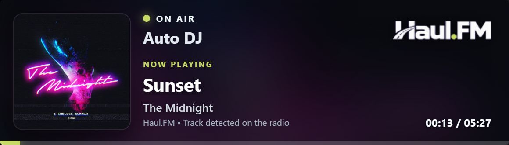

# HaulFM Overlay

[Suomi](README.md) | **English**

A Windows overlay that displays the track currently playing on Haul.FM in a small window that stays on top of other applications.

*English preview of version 1.2.21, captured in the application’s demo mode. The track, artwork and timing information change with the broadcast.*

## Download

**[Download HaulFM Overlay installer.exe](https://github.com/Walleyfire/haul-fm-stream-overlay/raw/refs/heads/main/HaulFM%20Overlay%20installer.exe)**

Requires 64-bit Windows, an internet connection and Microsoft Edge WebView2 Runtime, which is usually already installed on Windows. You do not need to install Python.

## Getting started

1. Download and run **HaulFM Overlay installer.exe**.
2. Select **English** or **Suomi** in the installer and follow its instructions. This also sets the overlay text and menu language. The application is installed for your Windows user account.
3. Open the overlay using the **HaulFM Overlay** shortcut on your desktop or in the Start menu.
4. Drag the card to move it. Drag an edge or corner to resize it. The position and size are remembered the next time you launch the overlay.

**You can delete the installer after installation.** The shortcut opens the installed application and does not need the downloaded installer.

The installation folder is `%LOCALAPPDATA%\Programs\HaulFM Overlay`. Administrator privileges are not required to install the overlay.

## Changing the language

The installer language also sets the application language. Select **English** for English overlay status text, the right-click menu and update messages. The selected language is preserved across application updates.

To change the language of an existing installation, close the overlay, run the latest installer again and choose the desired language. Open the overlay again using its shortcut.

## If WebView2 Runtime is missing

The HaulFM Overlay installer does not install WebView2 Runtime automatically. If the overlay reports that WebView2 is missing or does not open:

1. Open [Microsoft's official WebView2 download page](https://developer.microsoft.com/en-us/microsoft-edge/webview2/#download).
2. Find **Download the WebView2 Runtime** and select **Evergreen Standalone Installer → x64** for a standard 64-bit Intel/AMD Windows computer.
3. Download and run Microsoft's installer. Follow its instructions and wait for installation to finish.
4. Open **HaulFM Overlay** again using its desktop shortcut.

You can check for **Microsoft Edge WebView2 Runtime** in Windows **Settings → Apps → Installed apps**. If Microsoft's installer says the Runtime is already installed, you do not need to reinstall it. Installing the Edge browser alone does not replace installing the Runtime.

Reference: [Microsoft's WebView2 Runtime distribution guide](https://learn.microsoft.com/microsoft-edge/webview2/concepts/distribution).

## Features

- Current track title and artist.
- Prominent **LIVE DJ • presenter name** and show information during live broadcasts, or **Auto DJ** during automated broadcasts.
- Track artwork when available, with a fallback image otherwise.
- Rounded corners and adjustable size.
- An ON AIR indicator, NOW PLAYING text and progress bar matching the logo’s green accent.
- Finnish and English interfaces selected through the installer.
- Automatically saved window position and size.
- An overlay that stays on top of other windows.
- Time elapsed since the track was first detected. A progress bar appears when the track duration is known.
- A desktop shortcut and built-in update checking.

The timer starts when the application first detects a track. It does not represent the exact playback position of the broadcast. The application displays track information but **does not play radio audio**.

## Presenter information

The presenter and show name are read from Haul.FM’s own feed approximately every 15 seconds. Presenter text appears below ON AIR in a larger font. Automated broadcasts display **Auto DJ**. Breaks and connection failures have separate status messages. If presenter information cannot be refreshed, the old information expires after 90 seconds. Track metadata is fetched independently.

## Using the overlay with a game

Use **borderless fullscreen** or **windowed mode** so the overlay can appear above your game. Visibility in exclusive fullscreen mode is not guaranteed.

## Menu and closing the overlay

Right-click the overlay to open its menu. Labels follow the language selected in the installer:

| Menu label | Meaning |
| --- | --- |
| **Check for updates** / **Tarkista päivitykset** | Check for updates from GitHub. |
| **Close** / **Sulje** | Close the overlay. |

## Updates

**Latest version: 1.2.21.** To check for and install an update, right-click the overlay → **Check for updates** (Finnish: **Tarkista päivitykset**). Use **Close** (Finnish: **Sulje**) in the same menu to exit.

Starting with **1.2.20**, an update is accepted only if the downloaded EXE has an embedded Windows version greater than the running version. Equal, older, missing and invalid versions cannot be installed. The version is checked both when offering an update and before installation. If you see **“Update blocked: the EXE version is missing or invalid”**, that candidate is not installed.

Versions **1.2.18 and 1.2.19** do not include this protection. Close the old overlay and run the latest installer linked on this page to apply the fix.

The application also checks for updates at startup. When you approve an update, it downloads the new EXE, replaces the current executable and restarts. A backup of the previous executable is kept with a `.previous` suffix.

Updating requires an internet connection and write access to the application's folder. You can also close the overlay and run the latest installer again to update the existing installation in the same folder.

If an older version displays **Failed to load Python DLL** after updating, close the application and install the latest version using the installer linked above. The fix is included in version **1.2.10** and later.

## Recent changes

- **1.2.21:** presenter text is 50% larger (12 → 18 px) and bolder.
- **1.2.20:** fixed update logic that could reinstall an older version. Updates now require a strictly newer version number.
- **1.2.19:** added Haul.FM live presenter and show information, plus Auto DJ status.

- **1.2.18:** the installer language now controls the overlay language and persists across updates. Added English status text, menus and update messages. The ON AIR indicator, NOW PLAYING text and progress bar now match the logo’s green accent. Rounded clipping now applies to the whole window.

- **1.2.17:** fixed the mouse input regression in version 1.2.16. The right-click menu, moving and resizing work again. Rounded corner clipping is retained.

- **1.2.16:** fixed the rectangular background around the card. The area outside the rounded corners is transparent and the corner radius scales with the window.

- **1.2.15:** fixed the overlay being clipped or disappearing when enlarged. Resizing keeps the full card within the visible monitor area.

- **1.2.14:** removed the update-source setting from the right-click menu. The menu now contains **Tarkista päivitykset** (Check for updates) and **Sulje** (Close). Updated both Finnish and English instructions.
- **1.2.13:** the overlay remembers its position and size between launches. Added WebView2 Runtime installation instructions.
- **1.2.12:** added a standalone installer, Start menu shortcuts and uninstall support through Windows Settings. The installer can be deleted after installation.
- **1.2.11:** added the custom HaulFM application and shortcut icon.
- **1.2.10:** fixed restarting after an update and added a desktop shortcut.

## If version 1.2.16 does not respond to mouse input

Close **HaulFM-Overlay.exe** in Windows Task Manager and run the latest **HaulFM Overlay installer.exe**. Open the overlay again using its shortcut. Use the installer rather than the in-app update menu if the menu cannot be opened.

## If the overlay disappears after resizing

Close **HaulFM-Overlay.exe** using Windows Task Manager, then install the latest version using the installer linked above. Open the overlay again using its shortcut. Version **1.2.15** fixes large-size clipping and fits the window back onto the monitor at startup.

## Uninstalling

1. Close the overlay: right-click → **Close** (Finnish: **Sulje**).
2. Open Windows **Settings → Apps → Installed apps** (Windows 10: **Apps & features**).
3. Find **HaulFM Overlay** and select **Uninstall**.

Alternatively, open the **HaulFM Overlay** folder in the Start menu and select **Uninstall HaulFM Overlay** (Finnish: **Poista HaulFM Overlay**).

Uninstalling removes the installed application, its shortcuts, the update backup, the overlay's update and window position/size settings, and its saved icons. The original downloaded installer is not needed to uninstall. You can delete any installer left in your Downloads folder yourself.

If you previously used a standalone EXE without installing it, also delete that old `HaulFM-Overlay.exe` and its `.previous` backup, if present, from the folder where you originally saved them.

## Notes

Track information and artwork depend on the availability of external services. The application does not invent missing track information.

The executable is not digitally signed, so Windows may display a SmartScreen notification.

This is an unofficial Haul.FM overlay. Haul.FM names, logos and track artwork belong to their respective owners.
