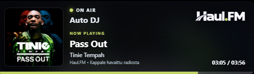

# HaulFM Overlay

**Suomi** | [English](README.en.md)

Kevyt Windows-overlay, joka näyttää Haul.FM-radion parhaillaan soivan kappaleen omassa, muiden ikkunoiden päällä pysyvässä ikkunassa.

*Kuvakaappaus version 1.2.21 suomenkielisestä käyttöliittymästä. Esimerkissä Auto DJ ja Tinie Tempahin Pass Out. Kappale, kansikuva ja aikatiedot vaihtuvat lähetyksen mukaan.*

## Lataa

**[Lataa HaulFM Overlay installer.exe](https://github.com/Walleyfire/haul-fm-stream-overlay/raw/refs/heads/main/HaulFM%20Overlay%20installer.exe)**

Windowsin 64-bittinen versio. Pythonia ei tarvitse asentaa. Sovellus tarvitsee internet-yhteyden ja Microsoft Edge WebView2 Runtimen, joka on yleensä valmiina Windowsissa.

## Käyttöönotto

1. Lataa **HaulFM Overlay installer.exe** ja käynnistä se.
2. Valitse installerissa **Suomi** tai **English** ja seuraa ohjeita. Valinta vaihtaa myös overlayn tekstit ja valikon. Sovellus asennetaan omalle Windows-käyttäjällesi.
3. Avaa overlay työpöydän tai Käynnistä-valikon **HaulFM Overlay** -pikakuvakkeesta.
4. Siirrä overlay vetämällä kortista ja muuta kokoa vetämällä reunasta tai kulmasta. Sijainti ja koko muistetaan seuraavalla käynnistyksellä.

**Installerin voi poistaa asennuksen jälkeen.** Pikakuvake avaa asennetun sovelluksen, joten se ei tarvitse ladattua installeria.

Asennuskansio on `%LOCALAPPDATA%\Programs\HaulFM Overlay`. Sovellus ei vaadi järjestelmänvalvojan oikeuksia.

## Kielen vaihtaminen

Installerin kielivalinta määrää myös sovelluksen kielen. **English** vaihtaa overlayn tilatekstit, hiiren oikean painikkeen valikon ja päivitysviestit englanniksi. Kieli säilyy myös päivitysten jälkeen.

Jos haluat vaihtaa jo asennetun sovelluksen kielen, sulje overlay, suorita uusin installer uudelleen ja valitse haluamasi kieli. Avaa overlay uudelleen pikakuvakkeesta.

## Jos WebView2 Runtime puuttuu

HaulFM Overlayn installer ei asenna WebView2 Runtimea automaattisesti. Jos overlay ilmoittaa puuttuvasta WebView2:sta tai ei avaudu:

1. Avaa [Microsoftin virallinen WebView2-lataussivu](https://developer.microsoft.com/en-us/microsoft-edge/webview2/#download).
2. Etsi **Download the WebView2 Runtime** ja valitse **Evergreen Standalone Installer → x64** tavalliselle 64-bittiselle Intel/AMD-Windows-koneelle.
3. Lataa ja käynnistä Microsoftin asennusohjelma. Seuraa sen ohjeita ja odota asennuksen valmistumista.
4. Avaa **HaulFM Overlay** uudelleen työpöydän pikakuvakkeesta.

Windowsin **Asetukset → Sovellukset → Asennetut sovellukset** -listasta voit tarkistaa, löytyykö **Microsoft Edge WebView2 Runtime**. Jos asennusohjelma kertoo sen olevan jo asennettu, sitä ei tarvitse asentaa uudelleen. Pelkkä Edge-selaimen asentaminen ei korvaa Runtime-asennusta.

Ohjeen lähde: [Microsoftin WebView2 Runtime -jakeluohje](https://learn.microsoft.com/microsoft-edge/webview2/concepts/distribution).

## Ominaisuudet

- Parhaillaan soiva kappale ja artisti.
- Selkeästi näkyvä **LIVE DJ • juontajan nimi** ja ohjelman nimi live-lähetyksissä; muulloin **Auto DJ** automaattisen lähetyksen aikana.
- Kappaleen kansikuva, kun se on saatavilla; muuten varakuva.
- Pyöristetyt kulmat ja säädettävä koko.
- Logon vihreään sävyyn sopivat ON AIR -piste, NOW PLAYING -teksti ja etenemispalkki.
- Suomen- ja englanninkielinen käyttöliittymä installerin valinnan mukaan.
- Ikkunan sijainnin ja koon automaattinen tallennus.
- Muiden ikkunoiden päällä pysyvä overlay.
- Kappaleen ensihavainnosta kulunut aika. Etenemispalkki näkyy, kun kappaleen kesto tunnetaan.
- Työpöydän pikakuvake ja sovelluksen sisäinen päivitystoiminto.

Aikalaskuri alkaa siitä, kun sovellus havaitsee kappaleen. Se ei ole lähetyksen tarkka toistoaika. Sovellus näyttää kappaletiedot, mutta **ei toista radion ääntä**.

## DJ-tiedot

DJ:n nimi ja ohjelman nimi haetaan Haul.FM:n omasta tietosyötteestä noin 15 sekunnin välein. DJ-teksti näkyy ON AIR -tekstin alla aiempaa suurempana. Kun lähetys on automaattinen, siinä lukee **Auto DJ**. Tauko ja yhteysvirhe näytetään omilla tilateksteillään. Jos DJ-tietoa ei saada päivitettyä, vanha tieto poistuu viimeistään 90 sekunnin kuluttua. Kappaletietojen haku toimii DJ-tiedoista erillään.

## Käyttö pelin kanssa

Valitse pelin näyttötilaksi **reunaton koko näyttö** tai **ikkunatila**, jotta overlay voi näkyä pelin päällä. Yksinomaisessa koko näytön tilassa näkyminen ei ole taattua.

## Valikko ja sulkeminen

Napsauta overlayta hiiren oikealla. Suomenkielisessä näkymässä valinnat ovat:

- **Tarkista päivitykset** tarkistaa GitHubista, onko nykyistä uudempi versio saatavilla.
- **Sulje** lopettaa sovelluksen.

## Päivitykset

**Uusin versio: 1.2.21.** Tarkista ja asenna päivitys napsauttamalla overlayta hiiren oikealla → **Tarkista päivitykset**. Sulkeminen onnistuu saman valikon **Sulje**-kohdasta.

Versiosta **1.2.20** alkaen päivitys hyväksytään vain, jos ladatun EXE:n Windows-versionumero on nykyistä suurempi. Sama tai vanhempi versio sekä puuttuva tai virheellinen versionumero estävät asentamisen. Tarkistus tehdään sekä päivitystä tarjottaessa että ennen asennusta. Jos näet ilmoituksen **”Päivitystä ei asenneta: EXE:n versionumero puuttuu tai on virheellinen”**, tarjottua tiedostoa ei asenneta.

Versioissa **1.2.18 ja 1.2.19** tätä suojausta ei vielä ole. Sulje vanha overlay ja suorita tämän sivun uusin asennin, jotta saat korjauksen käyttöön.

Uusi versio tarkistetaan myös käynnistyessä. Kun hyväksyt päivityksen, sovellus lataa uuden EXE:n, korvaa nykyisen tiedoston ja käynnistyy uudelleen. Aiemmasta EXE:stä jää `.previous`-varmuuskopio.

Päivitys vaatii internet-yhteyden ja kirjoitusoikeuden kansioon, jossa EXE sijaitsee. Voit myös sulkea sovelluksen ja suorittaa uusimman installerin uudelleen. Se päivittää aiemman asennuksen samaan kansioon.

Jos käytössäsi on vanha versio, jossa päivityksen jälkeen tulee **Failed to load Python DLL** -virhe, sulje sovellus ja asenna uusin versio yllä olevalla installerilla. Korjaus sisältyy versioon **1.2.10**.

## Viimeisimmät muutokset

- **1.2.21:** DJ-teksti on 50 % suurempi (12 → 18 px) ja vahvempi.
- **1.2.20:** korjattu päivityslogiikka, joka saattoi asentaa vanhemman version takaisin. Vain nykyistä suurempi versionumero hyväksytään.
- **1.2.19:** lisätty Haul.FM:n live-DJ:n nimi ja ohjelman nimi sekä Auto DJ -tila.

- **1.2.18:** installerin kielivalinta välittyy myös overlayyn ja säilyy päivityksissä. Lisätty englanninkieliset tila- ja päivitystekstit sekä valikko. ON AIR -piste, NOW PLAYING -teksti ja etenemispalkki ovat logon vihreän sävyiset. Vaihdettu kulmien rajaus koko ikkunan pyöristykseen.

- **1.2.17:** korjattu version 1.2.16 hiiren klikkausongelma. Hiiren oikean painikkeen valikko, siirtäminen ja koon muuttaminen toimivat jälleen. Pyöristettyjen kulmien rajaus säilyy.

- **1.2.16:** korjattu kortin ympärille jäävä suorakulmainen tausta. Kulmien ulkopuoli on läpinäkyvä ja pyöristys skaalautuu ikkunan mukana.

- **1.2.15:** korjattu overlayn leikkautuminen ja katoaminen suureksi venytettäessä. Koon muuttaminen pitää koko kortin näytön näkyvällä alueella.

- **1.2.14:** poistettu päivityslähteen vaihtaminen hiiren oikean painikkeen valikosta. Valikossa ovat **Tarkista päivitykset** ja **Sulje**. Päivitetty suomen- ja englanninkieliset ohjeet.
- **1.2.13:** overlay muistaa sijaintinsa ja kokonsa seuraavalla käynnistyksellä. Lisätty WebView2 Runtimen asennusohjeet.
- **1.2.12:** lisätty erillinen installer, Käynnistä-valikon pikakuvakkeet ja Windowsin kautta toimiva asennuksen poisto. Installerin voi poistaa asennuksen jälkeen.
- **1.2.11:** oma HaulFM-kuvake sovellukseen ja pikakuvakkeeseen.
- **1.2.10:** korjattu päivityksen jälkeinen uudelleenkäynnistys ja lisätty työpöydän pikakuvake.

## Jos version 1.2.16 overlay ei reagoi hiireen

Sulje **HaulFM-Overlay.exe** Windowsin Tehtävienhallinnasta ja suorita uusin **HaulFM Overlay installer.exe**. Avaa overlay sen jälkeen pikakuvakkeesta. Älä yritä päivittää hiirellä valikosta, jos valikko ei avaudu.

## Jos overlay ei näy suuren koon muuttamisen jälkeen

Sulje **HaulFM-Overlay.exe** Windowsin Tehtävienhallinnasta ja asenna uusin versio yllä olevalla installerilla. Avaa overlay uudelleen pikakuvakkeesta. Versio **1.2.15** korjaa suuren koon rajauksen ja sovittaa ikkunan takaisin näytölle käynnistettäessä.

## Asennuksen poistaminen

1. Sulje overlay: hiiren oikea painike → **Sulje**.
2. Avaa Windowsin **Asetukset → Sovellukset → Asennetut sovellukset** (Windows 10: **Sovellukset ja ominaisuudet**).
3. Etsi **HaulFM Overlay** ja valitse **Poista asennus**.

Vaihtoehtoisesti avaa Käynnistä-valikon **HaulFM Overlay** -kansiosta **Poista HaulFM Overlay**.

Poistaminen poistaa asennetun sovelluksen, sen pikakuvakkeet, päivityksen varmuuskopion sekä overlayn omat päivitys-, sijainti- ja kokoasetukset sekä tallennetut kuvakkeet. Alkuperäistä ladattua installeria ei tarvita poistamiseen. Lataukset-kansioon jääneen installerin voit poistaa itse.

Jos olet käyttänyt aiempaa erillistä, asentamatonta EXE-versiota, poista myös sen vanha `HaulFM-Overlay.exe` ja mahdollinen `.previous`-varmuuskopio siitä kansiosta, johon itse tallensit ne.

## Huomioitavaa

Kappaletiedot ja kansikuvat riippuvat ulkoisten palveluiden saatavuudesta. Puuttuvia kappaletietoja ei keksitä.

EXE:tä ei ole digitaalisesti allekirjoitettu, joten Windows voi näyttää SmartScreen-ilmoituksen.

Tämä on epävirallinen Haul.FM-overlay. Haul.FM:n nimet, logot ja kappaleiden kansikuvat kuuluvat omistajilleen.
