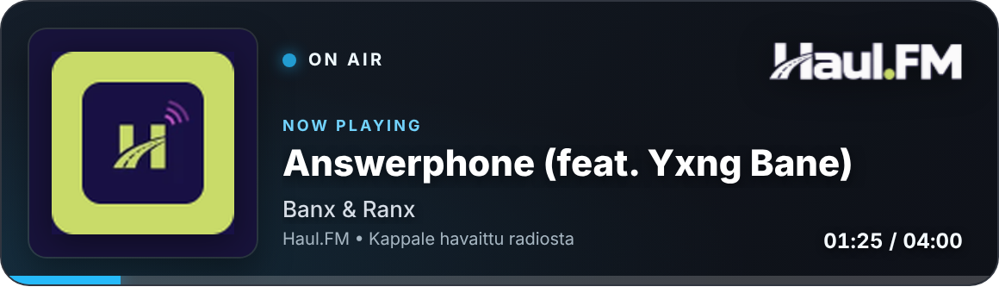

# HaulFM Overlay

Kevyt Windows-overlay, joka näyttää Haul.FM-radion parhaillaan soivan kappaleen omassa, muiden ikkunoiden päällä pysyvässä ikkunassa.

*Esimerkkikuva ulkoasusta. Kappale, kansikuva ja aikatiedot vaihtuvat lähetyksen mukaan.*

## Lataa

**[Lataa HaulFM-Overlay.exe](https://github.com/Walleyfire/haul-fm-stream-overlay/raw/refs/heads/main/HaulFM-Overlay.exe)**

Windowsin 64-bittinen versio. Pythonia ei tarvitse asentaa. Sovellus tarvitsee internet-yhteyden ja Microsoft Edge WebView2 Runtimen, joka on yleensä valmiina Windowsissa.

## Käyttöönotto

1. Tallenna `HaulFM-Overlay.exe` kansioon, jossa haluat säilyttää sovelluksen.
2. Käynnistä EXE. Overlay avautuu ja työpöydälle luodaan **HaulFM Overlay** -pikakuvake.
3. Siirrä overlay haluamaasi kohtaan vetämällä kortista.
4. Muuta kokoa vetämällä reunasta tai kulmasta. Mittasuhteet säilyvät.

Pidä EXE samassa kansiossa, jotta työpöydän pikakuvake toimii. Erillistä asennusohjelmaa ei tarvita.

## Ominaisuudet

- Parhaillaan soiva kappale ja artisti.
- Kappaleen kansikuva, kun se on saatavilla; muuten varakuva.
- Pyöristetyt kulmat ja säädettävä koko.
- Muiden ikkunoiden päällä pysyvä overlay.
- Kappaleen ensihavainnosta kulunut aika. Etenemispalkki näkyy, kun kappaleen kesto tunnetaan.
- Työpöydän pikakuvake ja sovelluksen sisäinen päivitystoiminto.

Aikalaskuri alkaa siitä, kun sovellus havaitsee kappaleen. Se ei ole lähetyksen tarkka toistoaika. Sovellus näyttää kappaletiedot, mutta **ei toista radion ääntä**.

## Käyttö pelin kanssa

Valitse pelin näyttötilaksi **reunaton koko näyttö** tai **ikkunatila**, jotta overlay voi näkyä pelin päällä. Yksinomaisessa koko näytön tilassa näkyminen ei ole taattua.

## Valikko ja sulkeminen

Napsauta overlayta hiiren oikealla:

- **Tarkista päivitykset** hakee GitHubissa olevan uusimman EXE:n.
- **GitHub-repository…** vaihtaa päivityslähteen. Tämän projektin osoite on valmiiksi asetettu.
- **Sulje** lopettaa sovelluksen.

## Päivitykset

Uusi versio tarkistetaan myös käynnistyessä. Kun hyväksyt päivityksen, sovellus lataa uuden EXE:n, korvaa nykyisen tiedoston ja käynnistyy uudelleen. Aiemmasta EXE:stä jää `.previous`-varmuuskopio.

Päivitys vaatii internet-yhteyden ja kirjoitusoikeuden kansioon, jossa EXE sijaitsee. Voit myös sulkea sovelluksen ja korvata EXE:n käsin yllä olevasta latauslinkistä.

Jos käytössäsi on vanha versio, jossa päivityksen jälkeen tulee **Failed to load Python DLL** -virhe, sulje sovellus ja lataa uusin EXE kerran käsin. Korjaus sisältyy versioon **1.2.10**.

## Huomioitavaa

Kappaletiedot ja kansikuvat riippuvat ulkoisten palveluiden saatavuudesta. Puuttuvia kappaletietoja ei keksitä.

EXE:tä ei ole digitaalisesti allekirjoitettu, joten Windows voi näyttää SmartScreen-ilmoituksen.

Tämä on epävirallinen Haul.FM-overlay. Haul.FM:n nimet, logot ja kappaleiden kansikuvat kuuluvat omistajilleen.
